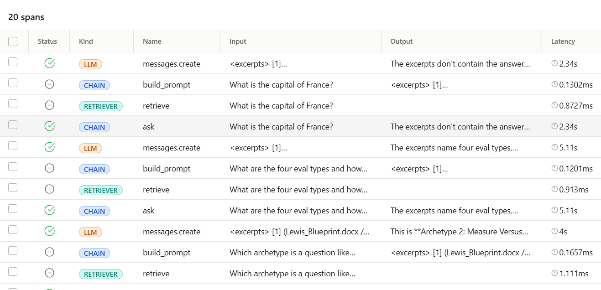

# Ask Chris

**A chat for recruiters to ask how I work, and a working demo of the kind of
AI product I build.**

## Why this exists

Instead of a resume bullet that says "builds AI products," Ask Chris lets you
ask directly. The answers come only from my own documents in [`docs/`](docs/):
my operating models, coaching frameworks, product roadmap playbook and trace
triage playbook. Each answer cites the excerpts it used, and when the documents
don't cover a question, it says so instead of guessing.

Questions you might ask:

- How does Chris take an AI product from idea to launch?
- What is Chris's approach to coaching a team?
- How does Chris decide what goes on a roadmap?
- How does Chris debug an AI feature that gives bad answers?

## The demo is the pitch

The way it's built is the other half of the answer:

- **Retrieval-augmented generation (RAG).** Documents are split at their
  headings, searched with BM25, and the best excerpts are sent to Claude with
  instructions to answer only from them and cite them.
- **A real chat interface.** A Streamlit chat page ([`chat.py`](chat.py)) on
  top of the same pipeline as the command-line tool ([`app.py`](app.py)).
- **Observability from day one.** Every question produces a trace in Arize
  showing what was retrieved, the exact prompt, Claude's response, tokens,
  cost and latency.
- **Built-in quality flags.** Each trace is tagged when retrieval was weak or
  the answer cited nothing, so ungrounded answers are easy to find and fix.

The rest of this README covers how to run it yourself.

## Setup (once)

You need Python 3.10 or newer and an Anthropic API key from console.anthropic.com.

### Windows (PowerShell)

```powershell
cd doc-qa
py -m venv .venv
.venv\Scripts\Activate.ps1
pip install -r requirements.txt
$env:ANTHROPIC_API_KEY = "sk-ant-..."
```

Run `phoenix serve` in one PowerShell window and `python app.py --demo` in a
second one (activate `.venv` and set the key in each). If PowerShell blocks the
activate script, run `Set-ExecutionPolicy -Scope CurrentUser RemoteSigned` once.

### Mac or Linux

```bash
cd doc-qa
python3 -m venv .venv
source .venv/bin/activate
pip install -r requirements.txt
export ANTHROPIC_API_KEY=sk-ant-...
```

## Run it

Terminal 1, start the trace viewer:

```bash
source .venv/bin/activate
phoenix serve
```

Terminal 2, ask questions:

```bash
source .venv/bin/activate
export ANTHROPIC_API_KEY=sk-ant-...
python app.py --demo                       # five sample questions
python app.py "What are the four eval types?"
python app.py                              # interactive chat
```

Then open http://localhost:6006 and click the **doc-qa** project.

### Chat in the browser (in progress)

> **In progress:** there is no public link to the chat yet. For now it only
> runs on your own machine with your own API keys, as described below.

On Windows, put your keys in a `.env` file (one `NAME=value` per line:
`ANTHROPIC_API_KEY`, `ARIZE_SPACE_ID`, `ARIZE_API_KEY`) and double-click
`start.bat`. Anywhere else:

```bash
streamlit run chat.py
```

Opens a chat page at http://localhost:8501 with the sample questions in the
sidebar. Each browser tab is one trace session.

## What each trace shows

```
ask  (CHAIN)              question in, answer out, flags in Metadata
├── retrieve  (RETRIEVER)     the 5 chunks pulled, with scores, source file and section
├── build_prompt  (CHAIN)     the exact excerpts sent to Claude
└── messages.create  (LLM)    the Claude call: full prompt, response, tokens, cost, latency
```

Here is a real run in Arize. Each question produces those four spans, and the
off-topic question ("What is the capital of France?") gets an answer that
declines instead of guessing:



The `ask` span carries metadata you can filter on in Phoenix:

| Flag | Meaning |
|---|---|
| `weak_retrieval` | Top retrieval score was low. The docs probably do not cover the question. |
| `no_citations` | The answer cited no excerpts. Check it for ungrounded claims. |
| `top_retrieval_score` | How strongly the best chunk matched. |
| `sources` | Which documents fed the answer. |

The fifth demo question, "What is the capital of France?", is deliberately off topic.
Its trace should show `weak_retrieval: true` and an answer that declines.

Each run of `app.py` is grouped as one **session** in Phoenix, so an
interactive chat appears as a single conversation.

## Coaching toolkit

The documents in `docs/coaching/` (the ACT Model, the ACT Group-Team Coaching
Model, Coaching Aims, Group Coaching Aims and the Coaching Question Cards) are not searched. They are sent whole
with every question, so Claude can:

- answer coaching and leadership questions with the ACT step that fits and
  1-3 matching question cards, using the team model and team cards for team
  situations;
- answer a vague question with one clarifying question in Chris's coaching
  style instead of guessing.

The chat remembers the last few turns, so a reply to a clarifying question
keeps its context. Traces flag toolkit citations under `cited_toolkit`.

## Adding documents

Drop `.docx`, `.md` or `.txt` files into `docs/` and run again. The index is
rebuilt on every start, so there is nothing else to do.

## Settings (environment variables)

| Variable | Default | Purpose |
|---|---|---|
| `CLAUDE_MODEL` | `claude-sonnet-5-5` | Which Claude model answers |
| `TOP_K` | `5` | How many chunks are sent to Claude |
| `PHOENIX_PROJECT` | `doc-qa` | Project name in Phoenix |
| `DOCS_DIR` | `./docs` | Folder to index |
| `PHOENIX_COLLECTOR_ENDPOINT` | `http://localhost:6006` | Send traces to a hosted Phoenix instead |
| `ARIZE_SPACE_ID` + `ARIZE_API_KEY` | unset | When both are set, traces go to Arize AX instead of Phoenix (no `phoenix serve` needed) |

## How it works

Retrieval uses BM25 keyword search, so it runs with no embedding model or
extra API key. Documents are split at their headings, and long sections are
cut into roughly 220-word chunks with overlap. Swapping in vector embeddings
later only changes `DocQA.retrieve`; the trace structure stays the same.
